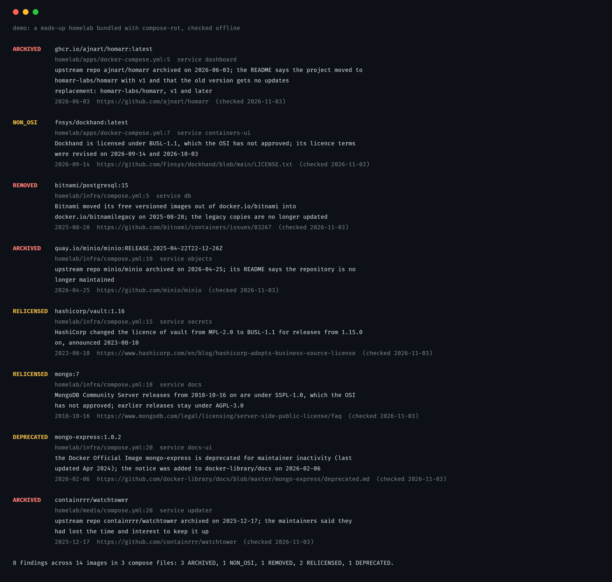

# compose-rot

[](https://github.com/kd-011/compose-rot/actions/workflows/ci.yml)

compose-rot reads your docker compose files and lists the images whose upstream has been archived, whose free catalogue was removed, or whose licence changed to one the OSI has not approved. Each finding has the file and line, the date, and a link to the page that says so.



## Try it

Needs Node 22 or newer. Nothing is installed or configured:

```sh
npx github:kd-011/compose-rot demo
```

It checks a made-up homelab that ships with the tool, offline, and exits 1 because it finds things.

## Install

```sh
npm install -g github:kd-011/compose-rot
compose-rot --version
```

It is not on the npm registry. There are no dependencies and nothing runs in the background. I develop and test it on Linux.

## Use it on your compose files

```sh
compose-rot check ~/stacks
compose-rot check compose.yml docker-compose.override.yml
```

It walks directories for `compose.yml`, `docker-compose*.yml`, `*.compose.yml` and the `.yaml` spellings, skipping `node_modules` and `.git`. For each service image it prints a finding if the image is in the data file. Exit codes: 0 no findings, 1 findings, 2 a file could not be read.

`--json` prints a versioned format for scripts, described in [docs/json-schema.md](docs/json-schema.md). `--verbose` also lists images it could not check and why.

Offline, it knows what is in [data/known.json](data/known.json): 25 images and namespaces so far, each with a source link and the date the page was opened. Examples are the Bitnami free catalogue, MinIO, Watchtower, File Browser, the HashiCorp products and MongoDB. [docs/data.md](docs/data.md) has the full format and how to add an entry.

## Online mode

```sh
GITHUB_TOKEN=... compose-rot check ~/stacks --online
```

`--online` finds each image's upstream repo and asks GitHub whether it is archived, when it was last pushed and what its licence is. It finds the repo from the data file first, then from the `org.opencontainers.image.source` label on the image in Docker Hub, ghcr.io or quay.io. If neither names a GitHub repo it says "upstream unknown" and leaves the image alone. It never guesses a repo from the image name.

Online it can add:

- ARCHIVED for an archived upstream repo.
- NON_OSI for a repo licensed BUSL-1.1, SSPL-1.0, Elastic-2.0, the Functional Source License, a PolyForm licence or the Commons Clause.
- STALE for a repo with no push in 24 months.

A licence GitHub cannot identify (`NOASSERTION`) is listed as unknown. Without `GITHUB_TOKEN` GitHub allows 60 requests an hour, and compose-rot waits when it hits the limit. Nothing is cached on disk and nothing is sent anywhere except the registry and the GitHub API.

## What the findings mean

REMOVED means the image or its free catalogue is gone or moved. ARCHIVED means the upstream repo is read-only. DEPRECATED means the maintainer or registry has marked it so. RELICENSED means the licence changed, and the finding names both. NON_OSI means the licence is one the OSI has not approved. The wording states a fact and a date and leaves the decision to you. [docs/reference.md](docs/reference.md) has each kind in full.

## Compared with other tools

Renovate and Diun tell you when a newer tag exists. Trivy, Grype and Docker Scout report vulnerabilities in what you run. I searched GitHub and the web on 2026-11-03 and found no tool that takes a compose file and reports the upstream's archived or licence status.

## When not to use it

- You want to know whether your tags are current or your images have known vulnerabilities. It reads neither.
- You use Kubernetes, Helm or Dockerfiles. It reads compose files only.
- You need the data to be complete. The data file is short and curated, and online mode depends on images setting a source label. [docs/limitations.md](docs/limitations.md) lists what it does not check.

## Contributing

See [CONTRIBUTING.md](CONTRIBUTING.md). `node --test` runs the suite. [CHANGELOG.md](CHANGELOG.md) lists what changed.

## Licence

MIT, see [LICENSE](LICENSE).
